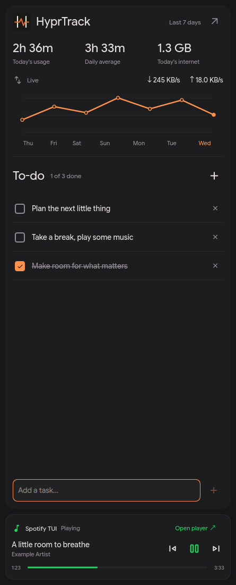
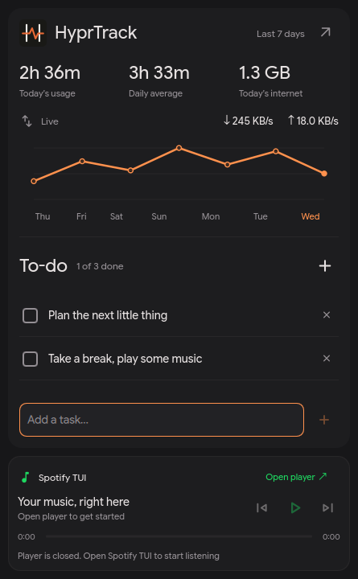

# Spotify in my sidebar

Spotify TUI lives at the bottom of Super+A now, so I can control music without
keeping the full Spotify desktop app around. Super+S opens the terminal player.
The sidebar button just says **Open player**; there is no shortcut label on it.
This is a personal desktop integration. It does not change the Spotify-Tui app.



Actual QuickShell component capture with isolated sample tasks, usage and song
metadata. These are generic fixtures, not my playlists or listening history.

## Using it

| Action | How |
| --- | --- |
| Open the sidebar | Super+A |
| Open Spotify TUI | Super+S, or **Open player** |
| Return to an existing player | Use either launcher again; it focuses the existing window |
| Pause or resume | Centre transport button; the icon follows confirmed playback state |
| Change songs | Previous / next buttons |
| Seek | Click or drag the green progress slider |
| Navigate controls | Tab / Shift+Tab; Enter or Space activates a focused button |
| Seek with the keyboard | Focus the slider, then use arrow keys |
| Add a task | Type immediately after opening Super+A, then Enter |

Task entry stays below the scrolling task list. Long task lists cannot push it
or the player out of the drawer. The usage summary keeps its natural height,
including while loading. The original drawer width and existing task storage stay
in place. The Spotify card stays below every sidebar page, if other pages are enabled.
Super+S replaces the old custom Stremio shortcut. Super+Return still opens a normal terminal.

When the player is closed or disconnected, playback buttons are disabled and
**Open player** stays available. Open the TUI and press `c` to reconnect when
needed. Pick a song there to begin. The sidebar does not start audio by itself.



## Recreate on Arch

Requirements: the existing end-4 QuickShell/Lua Hyprland desktop, Python 3 and
Kitty. The bridge uses Python's standard library. Install the Linux x86_64
Spotify TUI release under `~/.local`, not from a development `dist` folder:

```bash
mkdir -p ~/Downloads/spotify-tui-install
cd ~/Downloads/spotify-tui-install
curl -fL https://github.com/wrestle-R/Spotify-Tui/releases/download/v0.3.1/download-linux.sh -o download-linux.sh
less download-linux.sh
bash download-linux.sh --destination ./spotify-tui-linux
bash ./spotify-tui-linux/install.sh
~/.local/bin/spotify-tui version
```

For a fresh account setup, get the Soloist binary from Spotify and use your own
public developer client ID. Register `http://127.0.0.1:43821/callback` in that
developer app. Then run:

```bash
~/.local/bin/spotify-tui setup --client-id YOUR_PUBLIC_CLIENT_ID --soloist-path /absolute/path/to/soloist
~/.local/bin/spotify-tui login
~/.local/bin/spotify-tui provider-key
~/.local/bin/spotify-tui
```

Sign in through your normal browser. Type the personal Soloist key into the
hidden terminal prompt. Keep keys and tokens out of Git. Initial device pairing
may need another official Spotify client on the same LAN. Test independent audio
before removing that client. Premium is required for this playback provider;
offline downloads remain unsupported. See the app's
[setup guide](https://github.com/wrestle-R/Spotify-Tui/blob/main/docs/SETUP.md)
for provider downloads, pairing and keyring help.

Apply this personal sidebar package after the base desktop is installed:

```bash
cd ~/Desktop/code/Linux
python3 End-4/sidebar/customizations.py check
python3 End-4/sidebar/customizations.py install
hyprctl reload config-only
hyprctl configerrors
touch ~/.config/quickshell/ii/shell.qml
```

Save any task draft before reloading the shell. Existing saved tasks are reused.
The installer prints a private backup directory and refuses unknown source edits.
If using only the fork, run the same commands with
`~/Desktop/dots-hyprland/dots/.config/hypr/custom/sidebar/customizations.py`.
After installation, the equivalent live package is under
`~/.config/hypr/custom/sidebar/`.

After audio works independently, removing the official Arch package is optional:

```bash
sudo pacman -R spotify
```

This removes only the official package. Keep Soloist, the TUI installation,
keyring and account configuration. There is no dependency cleanup or private-data
deletion in this setup. On this machine the official package was removed on
28 October 2026 and the TUI playback checks passed without it.

## Where the pieces go

| File | Purpose / installed destination |
| --- | --- |
| `SpotifyMiniPlayer.qml` | Footer component in live `quickshell/ii/modules/ii/sidebarLeft/` |
| `SidebarDashboard.qml` | Existing usage/tasks dashboard, with fixed task entry |
| `SidebarLeftContent.qml` | Supported integration source, adds the footer below the pages |
| `spotify-sidebar.py` | Local IPC adapter in `hypr/custom/scripts/` |
| `spotify-shortcuts.lua` | Super+S override in `hypr/custom/` |
| `customizations.py` | Compatibility check, full config backup, install and restore |
| `asset-versions.json` | Explicitly supported previous custom asset hashes |
| `sidebar-integration.json` | Exact supported upstream/current/previous entry-point text |

The adapter reads the installed helper's private Unix socket at
`$XDG_RUNTIME_DIR/spotify-tui/player.sock`. It exposes only playback metadata to
the card, validates protocol version/request ID and bounds response size/time.
Commands go straight to the helper; pause state is not guessed locally. The
launcher uses the installed `~/.local/bin/spotify-tui` and this Lua Hyprland
version's focus dispatcher. It refuses to launch another window if inspecting or
focusing an existing one fails.

One watcher runs while the sidebar is open and makes a local state request about
once a second. It stops when hidden, including after a watcher restart. No account
credentials, listening history, album art downloads, extra network polling or
background systemd service are added by this integration. No RAM savings figure
has been measured for this desktop setup.

## Pulls, upstream updates and rollback

The canonical package is `Linux/End-4/sidebar/`. Its matching fork copy is
`dots/.config/hypr/custom/sidebar/`. The fork's upstream QuickShell source files
remain pristine; install patches only the live desktop. Pulling the fork updates
the rebuild package, not an already-running copy of QuickShell.

Before an upstream end-4 update, make a backup and run the source compatibility
check after merging upstream, before replacing the working desktop:

```bash
python3 ~/Desktop/code/Linux/End-4/sidebar/customizations.py backup
git -C ~/Desktop/dots-hyprland pull --ff-only origin main
python3 ~/Desktop/dots-hyprland/dots/.config/hypr/custom/sidebar/customizations.py check --config-root ~/Desktop/dots-hyprland/dots/.config
```

Use the Linux README's full update sequence for clipboard and settings too.
After reviewing and running upstream `./setup install`, preserve the custom
folder, check and reinstall all custom integrations, then reload Hyprland and
QuickShell. The Spotify load hook is inserted before the settings hook, preserving
the settings installer's final block and existing shortcuts. Reinstalls do not
append duplicate hooks. Future incompatible upstream code stops the installer
before writes and needs a reviewed adapter update; it is not silently overwritten.

To roll configs back, use the exact snapshot printed by the installer:

```bash
python3 End-4/sidebar/customizations.py restore --backup /absolute/path/to/snapshot
hyprctl reload config-only
touch ~/.config/quickshell/ii/shell.qml
```

Restore backs up the state it replaces. It restores configuration, not packages
or account data. Reinstall official Spotify separately if you want that app back.

## Verification, 28 October 2026

- 25 Python checks pass: analytics, passive network reads, socket protocol,
  bounded failures, metadata filtering, focus-without-spawn, supported upgrades,
  settings-hook preservation, unknown-edit refusal, idempotency, rollback and restore.
- Isolated running QuickShell controls sent pause/resume, next, previous and seek
  through the actual adapter into a synthetic local playback socket. Button labels
  followed state. The disconnected card disabled transport controls.
- Polling stopped while hidden and resumed on reopening. Tab order includes open,
  previous, pause/resume, next and seek when playback is ready.
- At 720px height, both loading and loaded usage states left room for the task
  list, fixed input and footer. Fixture task submission persisted only in isolated
  test state. Public screenshots contain fixture data only.
- Real installed-player pause, resume and seeking confirmed with the official
  desktop package absent. The original paused state/position were restored.
  Repeated launcher calls left one terminal window, using Lua Hyprland focus.

Run the automated checks from the Linux repo with:

```bash
python3 -m unittest discover -s End-4/sidebar -p 'test_*.py'
python3 End-4/sidebar/customizations.py check
```

Long-session stability and RAM measurements are still separate work. This bridge
depends on Spotify TUI's version-1 local socket protocol; recheck it after app
updates. It does not add offline playback, full library browsing inside the
sidebar or an MPRIS bridge. Those were not needed for the compact controls here.
